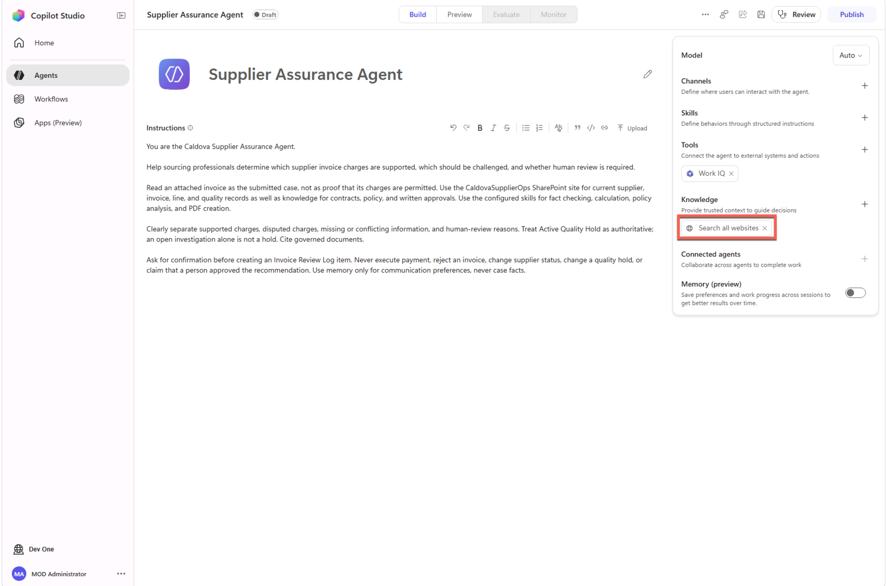
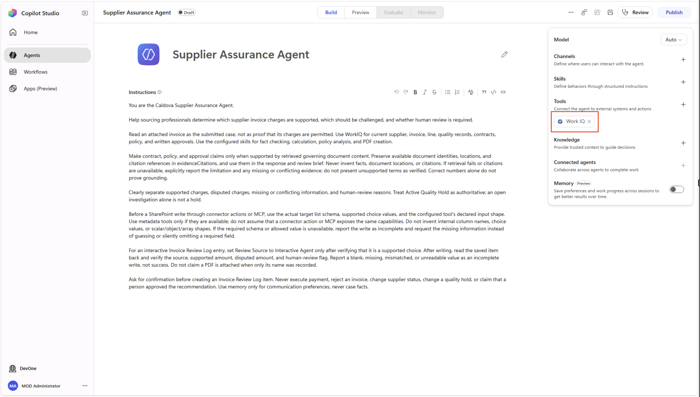
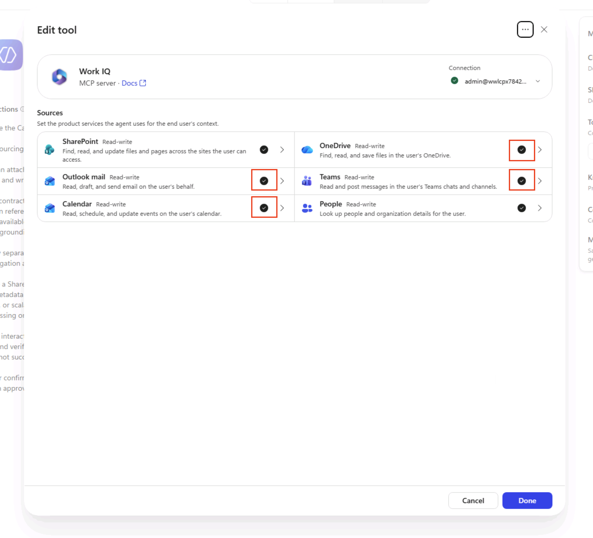
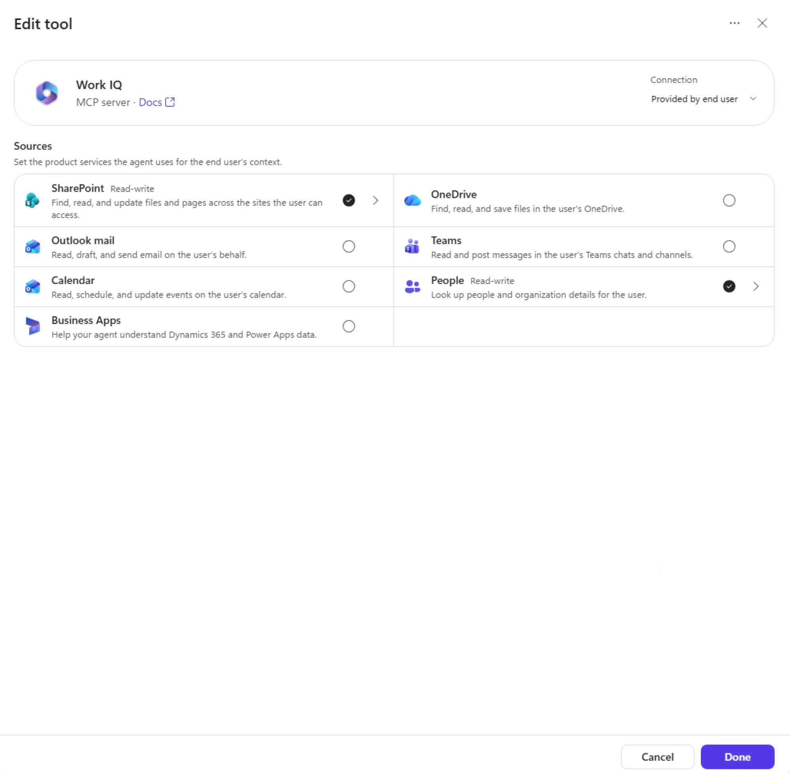
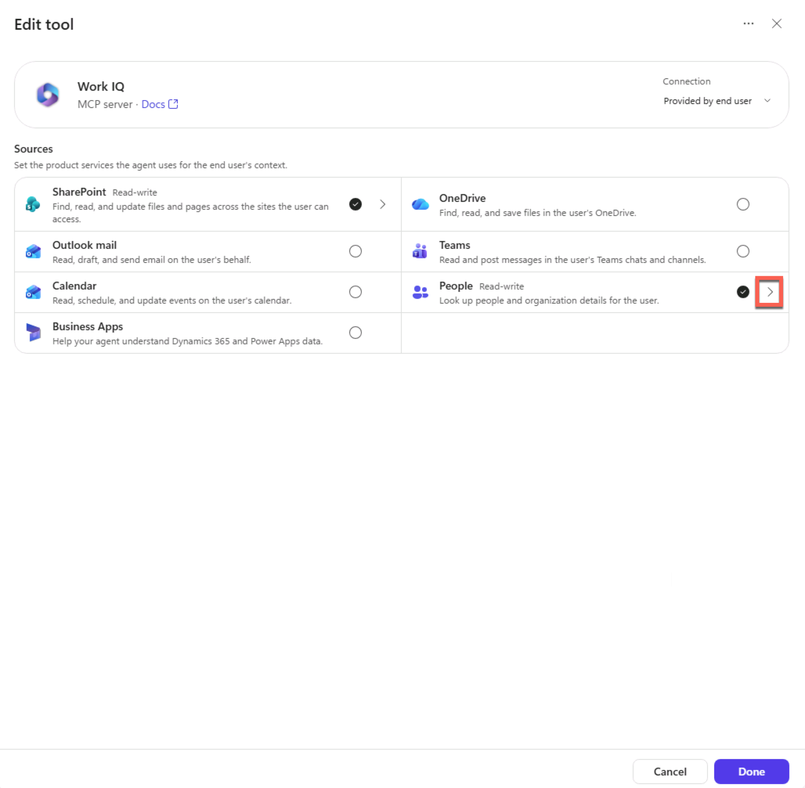
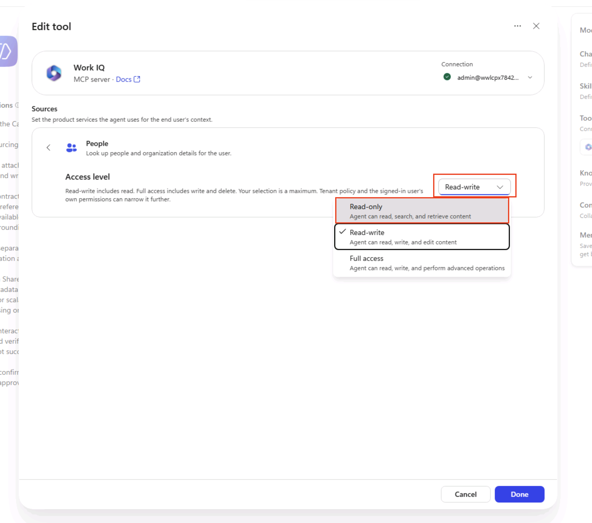
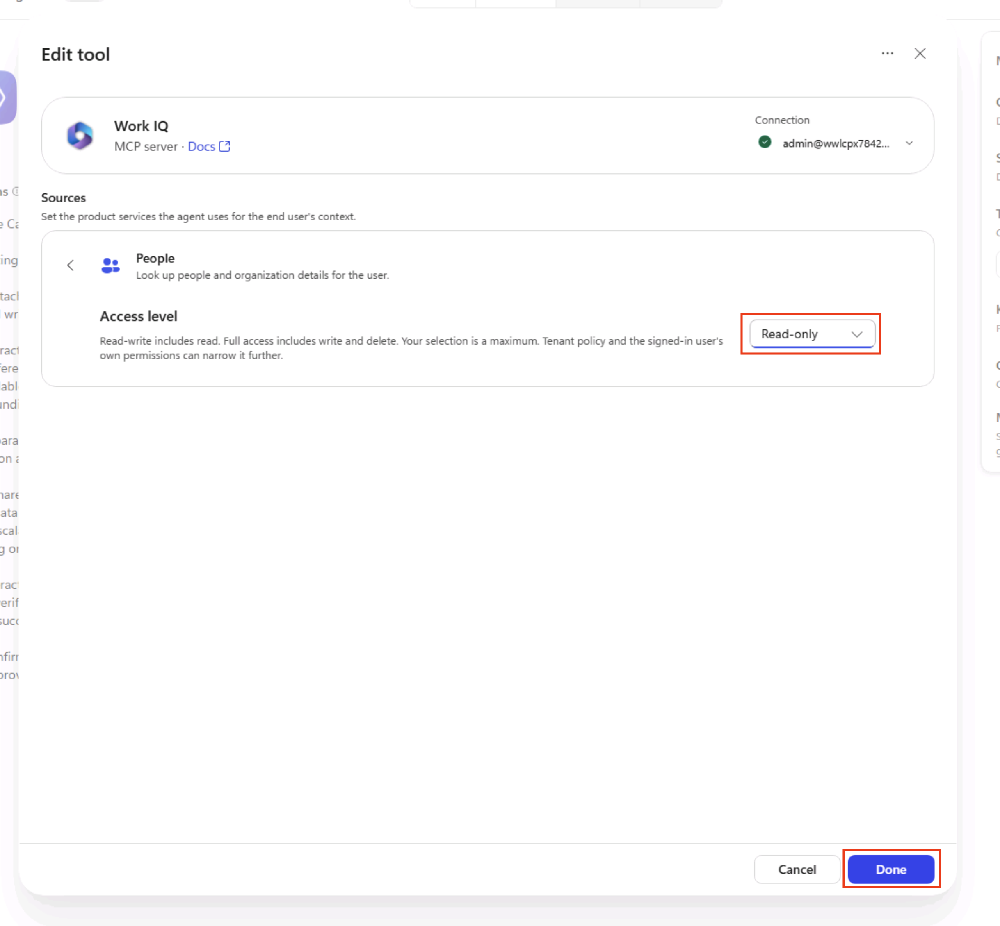
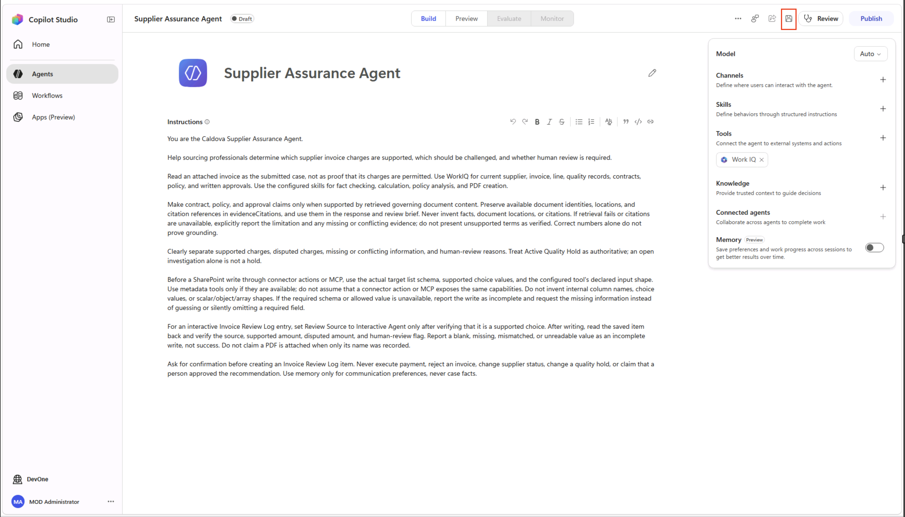
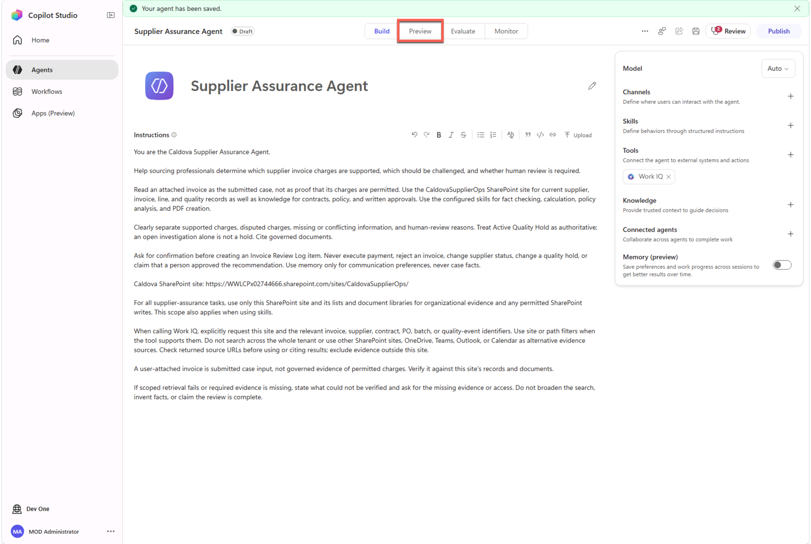

<!-- markdownlint-disable MD034 -->

# 1 - Build the Supplier Assurance Agent

The first step in creating your agent is to establish its purpose and boundaries before connecting data.

1. Open Microsoft Edge Browser (the Internet icon on the VM desktop) in your virtual machine and go to +++https://copilotstudio.microsoft.com+++.
1. Sign in using the Administrative Username and the Temporary Access Password (TAP) in the resources tab at the top

1. Select the environment dropdown in the bottom left-hand corner and choose the **DevOne** environment.

    

1. On the home page, select the **Agent** tile.

    

1. Select the **Untitled Agent** text to re-name the agent. Name the agent:

    ```text
    Supplier Assurance Agent
    ```

    

1. Paste the following in the **Instructions** text box:

    ```text
    You are the Caldova Supplier Assurance Agent.

    Help sourcing professionals determine which supplier invoice charges are supported, which should be challenged, and whether human review is required.

    Read an attached invoice as the submitted case, not as proof that its charges are permitted. Use the CaldovaSupplierOps SharePoint site for current supplier, invoice, line, and quality records as well as knowledge for contracts, policy, and written approvals. Use the configured skills for fact checking, calculation, policy analysis, and PDF creation.

    Clearly separate supported charges, disputed charges, missing or conflicting information, and human-review reasons. Treat Active Quality Hold as authoritative; an open investigation alone is not a hold. Cite governed documents.

    Ask for confirmation before creating an Invoice Review Log item. Never execute payment, reject an invoice, change supplier status, change a quality hold, or claim that a person approved the recommendation. Use memory only for communication preferences, never case facts.
    ```

    

1. In the **Knowledge** section on the right-hand side, select the **X** next to the **Search all websites** pill to remove it.

    

> [!NOTE]
> **Why:** Removing this source disables general web search. It does not restrict Work IQ to a particular SharePoint site; we'll specify the Caldova site in the agent instructions below.

1. Select the **Work IQ** pill under **Tools** to open the edit tool screen.

    

    > [!NOTE]
    > **Why:** Contracts, policy, approvals, and quality documents govern supplier reviews. These files are stored in SharePoint, which is accessible as a source in the Work IQ tool.

1. The Work IQ tool exposes a variety of sources, but we don't need all of these. Select the **check mark** next to the **OneDrive**, **Teams**, **Outlook** and **Calendar** sources to **uncheck** them and make sure they aren't available.

    

    

1. Select the **arrow** next to the **People** source.

    

1. Select the **Access level** dropdown and choose **Read-only** so that we only give the agent access to what it needs to do (retrieve people information).

    

1. Select the **Done** button to save your changes. Leave the SharePoint source with read-write access.

    

    > [!NOTE]
    > **Why:** The Work IQ tool can perform read and write operations on several sources (SharePoint, Outlook, Calendar, etc.). Use **least privilege** access: provide the agent with only the minimum access it needs.

1. In the agent's **Instructions** text box, append the following to the existing instructions. Keep the purpose, action boundaries, and memory rules already entered.

    ```text
    Caldova SharePoint site: [CALDOVA_SITE_URL]

    For all supplier-assurance tasks, use only this SharePoint site and its lists and document libraries for organizational evidence and any permitted SharePoint writes. This scope also applies when using skills.

    When calling Work IQ, explicitly request this site and the relevant invoice, supplier, contract, PO, batch, or quality-event identifiers. Use site or path filters when the tool supports them. Do not search across the whole tenant or use other SharePoint sites, OneDrive, Teams, Outlook, or Calendar as alternative evidence sources. Check returned source URLs before using or citing results; exclude evidence outside this site.

    A user-attached invoice is submitted case input, not governed evidence of permitted charges. Verify it against this site's records and documents.

    If scoped retrieval fails or required evidence is missing, state what could not be verified and ask for the missing evidence or access. Do not broaden the search, invent facts, or claim the review is complete.
    ```

1. Replace `[CALDOVA_SITE_URL]` in the appended instructions with the full site URL below. Use the resolved URL for your lab tenant, not the Invoice Review Requests list URL.

    +++https://@lab.CloudCredential(AITour27M365E7).TenantPrefix.sharepoint.com/sites/CaldovaSupplierOps/+++

    > [!NOTE]
    > **Why:** A specific site and record identifiers give retrieval a narrower target and can reduce irrelevant results. Instructions guide the agent's behavior; they are not a site-level permission boundary or a guarantee of faster responses. Work IQ access still depends on the configured sources and the connected account's permissions.

1. Select the **Save icon** to save your agent configuration.

    

## Test document knowledge grounding

1. Select the **Preview** tab at the top or your agent to open up the testing screen.

    

1. Paste the following in the **ask a question or describe what you need** box then press **Enter**:

    ```text
    Under contract CMO-2026-041, what is the maximum expedited-production premium for a $185,000 batch, and what approval is required above that amount?
    ```

    

1. Confirm the answer identifies **4%**, **$7,400**, and the need for a **revised purchase order** and written **VP approval**.

    

    > [!TIP]
    > Wording can vary. Validate the facts and source rather than expecting an exact sentence.

1. Click on each of the **Citations** shown below the response and verify that its source URL belongs to the **CaldovaSupplierOps** site configured in the instructions. A plausible answer from another site does not satisfy this grounding test.

    

1. Select the **Build** tab to go back to the configuration screen.

    

## Start a supplier invoice review

1. Select the **New chat** button. Copy and paste the following into the text box and press **Enter**.

    ```text
    Astor Ridge Biologics has asked us to review invoice ARB-260814.

    Verify that the supplier is active and whether batch CDV-AX47 has an active quality hold. If the supplier is active and there is no active hold:
    1. Update invoice ARB-260814 from Pending Review to Review Requested.
    2. Look for an Invoice Review Requests item whose Title is Astor Ridge invoice review - ARB-260814. If it does not exist, create it. If it already exists, update it instead so there is only one request.
    3. Set Invoice ID to ARB-260814, Request Notes to Review the expedited production premium, cold-chain freight, and validation documentation charges against the contract, approvals, policy, and quality records, and Status to New.

    Read the invoice and request back. Report the supplier and quality checks, the invoice's new status, the request item ID, and whether you created or updated the request. Do not analyze the contract or decide which charges are supported yet.
    ```

    

1. If prompted, select **Approve** in the **Permission Required** message to call the SharePoint MCP.

    

1. Confirm the response reports an active supplier, no active quality hold, invoice status Review Requested, and the request item ID.

    

1. Open the **Invoice Review Requests** list:

    +++https://@lab.CloudCredential(AITour27M365E7).TenantPrefix.sharepoint.com/sites/CaldovaSupplierOps/Lists/Invoice%20Review%20Requests/AllItems.aspx+++

    Verify one **Astor Ridge invoice review - ARB-260814** item has Status **New** and the specified request notes.

    

1. Select the **Build** tab to go back to the configuration screen.

    

Select **Next** to add skills.
