<!-- markdownlint-disable MD034 -->

# 5 - Publish and Test in Microsoft 365 Copilot

Now it's time to make your agent available to others in your org.

## Add the Microsoft 365 Copilot channel

1. Return to +++https://copilotstudio.microsoft.com+++. Open your existing **Supplier Assurance Agent**.

    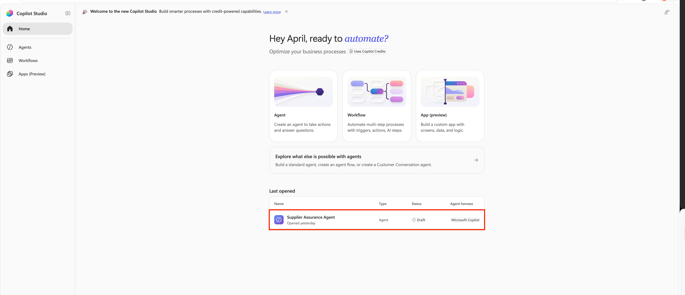

1. Select the **plus button** next to **Channels**.

    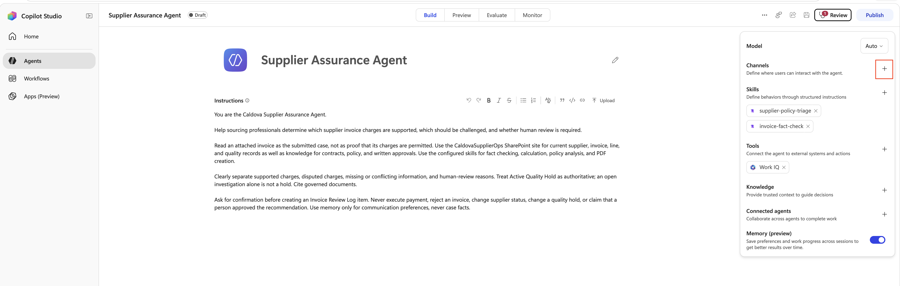

1. Select the **Teams + Microsoft 365** tile.

    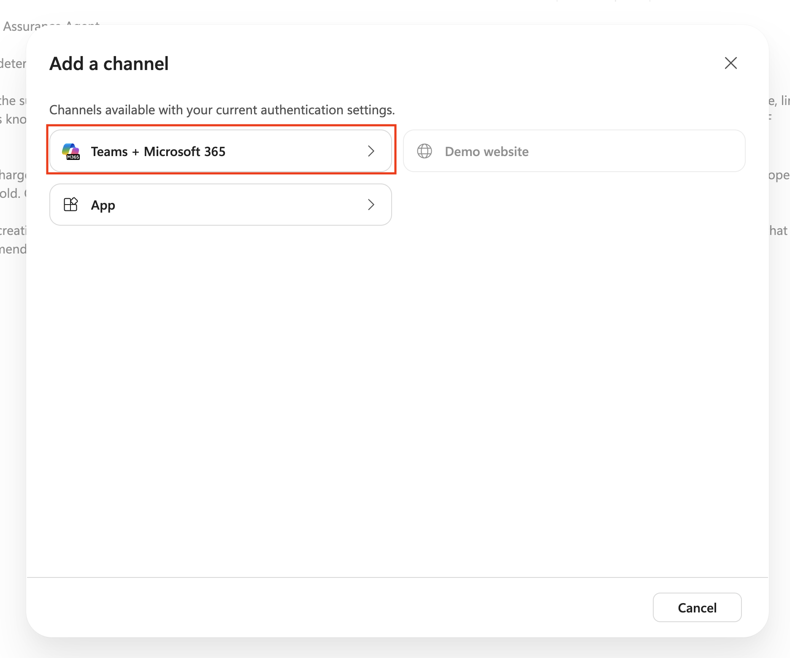

1. Select **Microsoft Copilot and Microsoft Teams** then select **Add channel**.

    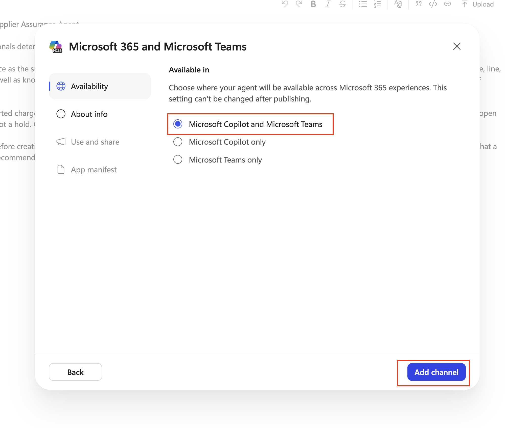

1. Confirm that the Teams + Microsoft 365 channel shows then select **Publish**.

    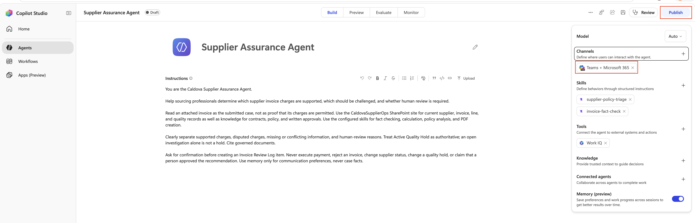

1. In the dialog, select **Publish agent**.

    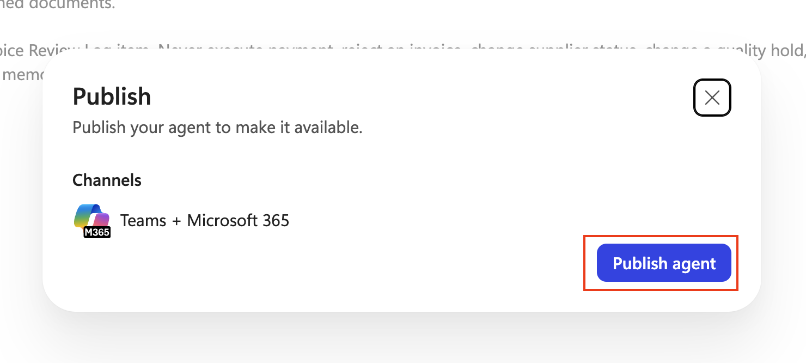

1. Wait for publishing to succeed. Then select **View in Teams + Microsoft 365**

    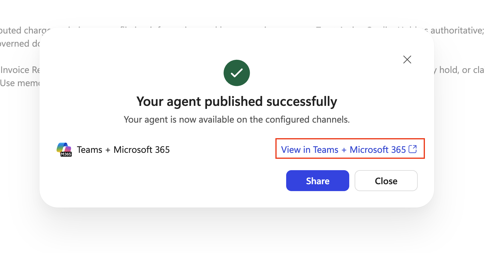

1. Select **Cancel** in the teams pop up then select **Use the web app instead**.

    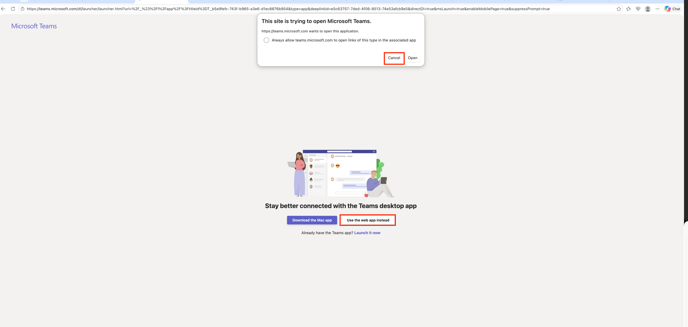

1. Select **Add** in the dialog that shows your Supplier Assurance Agent in teams.

    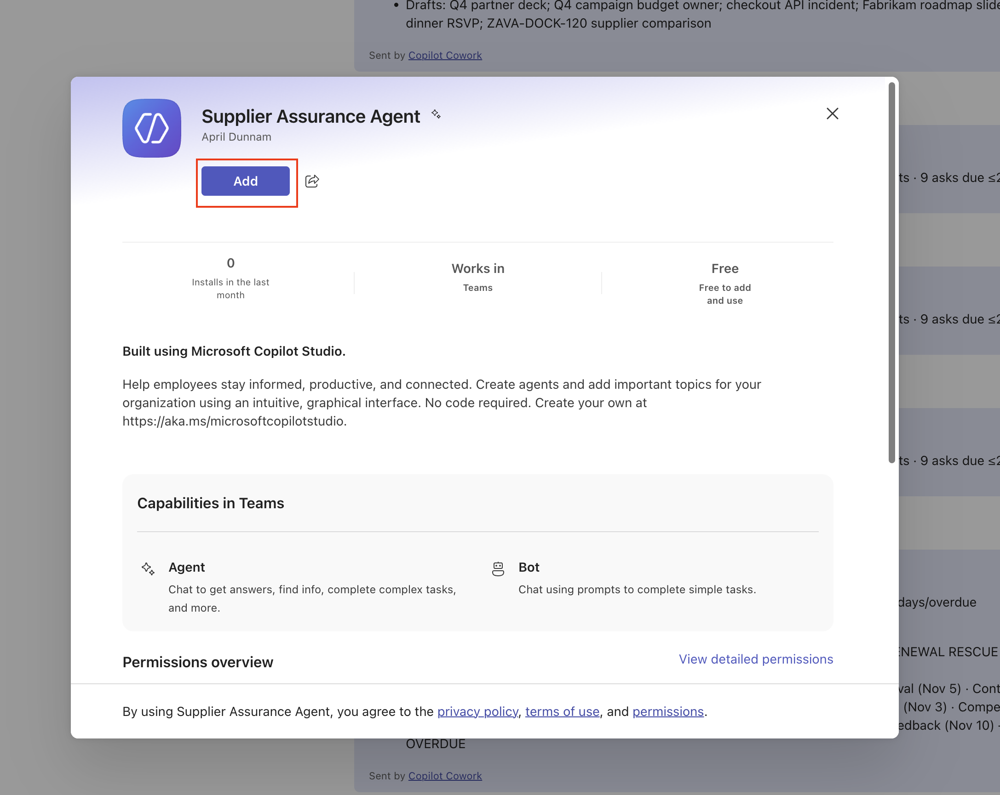

1. Select **Open with Copilot** in the dialog showing that your agent was added.

    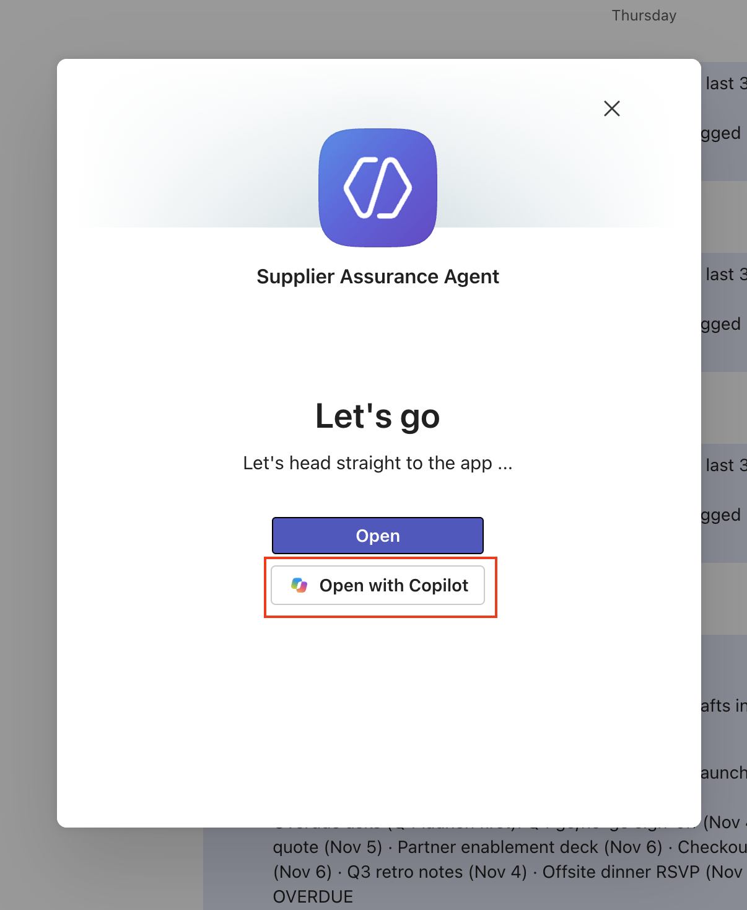

## Test the agent

1. In the conversation with your agent, send:

    ```text
    Under contract CMO-2026-041, what is the maximum expedited-production premium for a $185,000 batch, and what approval is required above that amount? Cite the governing source. Do not change any records.
    ```

    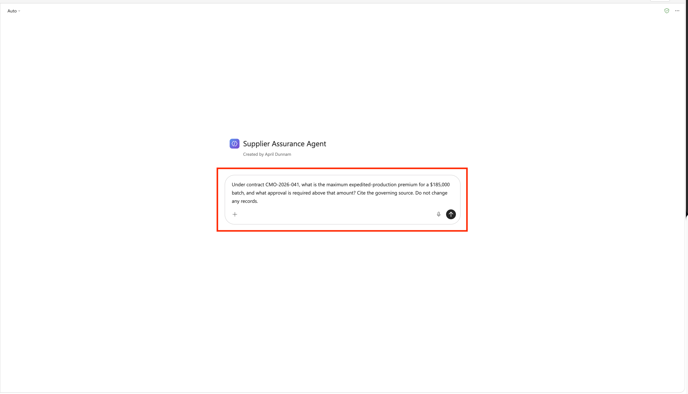

1. Confirm the answer identifies **4%**, **$7,400**, and the need for a **revised purchase order** and written **VP approval** above that amount.

    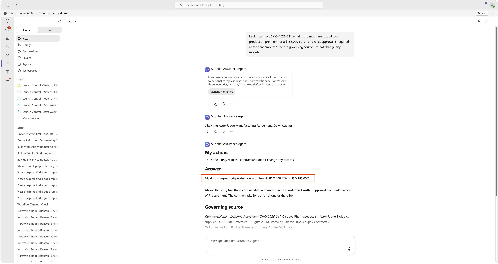

Congratulations. The required lab is complete. If time permits, select **Next** to see how to create an app in Copilot Studio and build an agent from Coplot Cowork. Otherwise, skip the bonuses and select **Submit** when the lab completion screen appears.
