<!-- markdownlint-disable MD034 -->

# Bonus - Build the Supplier Assurance Dashboard

Your agent can review invoices, and your workflow can run a review when a request arrives. But a sourcing manager still needs a place to see which suppliers need attention without opening every SharePoint list or reading every agent conversation.

In this optional bonus lab, you'll use **Apps** in Copilot Studio to create a **Caldova Supplier Assurance Dashboard**. The app brings supplier status, invoice exposure, quality holds, and review results into one experience to help us decide what to investigate next. The required agent and workflow labs are already complete; you can skip this bonus without affecting them.

## Create the app

1. Return to +++https://copilotstudio.microsoft.com+++ and select the **Home** tab.

1. Select the **App** tile.

    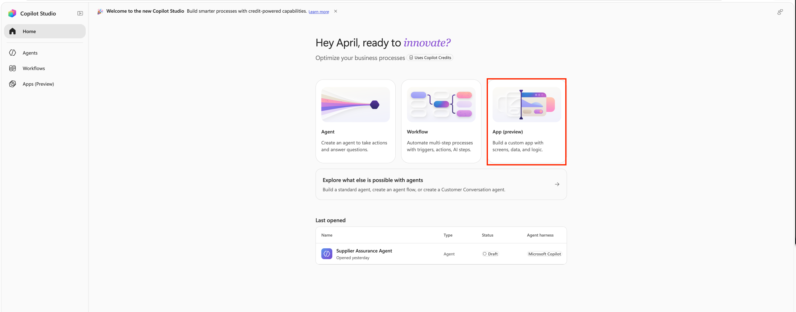

1. Copy and paste the following into the conversation area:

    ```text
    Create an app named Caldova Supplier Assurance Dashboard for a sourcing manager at Caldova Pharmaceuticals.

    Purpose: Help a human see which suppliers and invoice reviews need attention after the Supplier Assurance Agent reviews invoices and a Copilot Studio workflow stores the response. This is a monitoring app, not an invoice approval or payment system.

    Use the existing SharePoint lists and their fields from this site: +++https://@lab.CloudCredential(AITour27M365E7).TenantPrefix.sharepoint.com/sites/CaldovaSupplierOps+++

    Read all relevant records, including additional pages of results. Join suppliers to invoices and quality events using Supplier ID. Join requests and review logs to invoices using Invoice ID matched to the invoice Title. Never join by supplier display name.

    Build a clean, accessible overview with:
    - Cards for supplier count, total submitted invoice value, suppliers with an active quality hold, and invoices with a recorded human-review-required flag.
    - A searchable supplier table showing supplier name, ID, status, risk tier, submitted invoice value, active-hold indicator, and invoices needing human review.
    - Supplier and risk-tier filters, an Only needs attention toggle, and a Refresh data button.
    - Selecting a supplier opens its invoice and quality details in the same app.

    A supplier needs attention when its Status is not Active, at least one quality event has Active Quality Hold = Yes, or at least one invoice's latest review log has Human Review Required = Yes. Explain which conditions caused the flag. Do not invent a numeric supplier score or use Risk Tier alone as an approval decision.

    In the detail view:
    - Show each invoice's submitted total and its source status.
    - Show each review request's workflow status, full Agent Response, and Error Detail when present. Allow selecting an individual request if an invoice has multiple requests.
    - Show supported and disputed amounts only from a structured Invoice Review Log record. If multiple logs exist for an invoice, use the record with the highest SharePoint item ID as the latest recorded review and keep earlier records available as history. Count each invoice once in review-based metrics.
    - If a structured log is missing, display Not recorded for its amounts and human-review flag. Still display any available workflow response as text; do not extract amounts or approval status from that prose.
    - Keep missing amounts separate from zero. Do not sum different currencies into one total; show totals grouped by Currency.
    - Show quality event status separately from Active Quality Hold. An open investigation with Active Quality Hold = No is not an active hold.

    Use text as well as color for statuses, labelled controls, keyboard-accessible interactions, readable currency formatting, and a layout usable on a laptop.

    Include this notice: Recommendations only. Financial decisions remain with authorized reviewers.
    ```

1. Select **Enter** or the **Up arrow** to send in your prompt.

    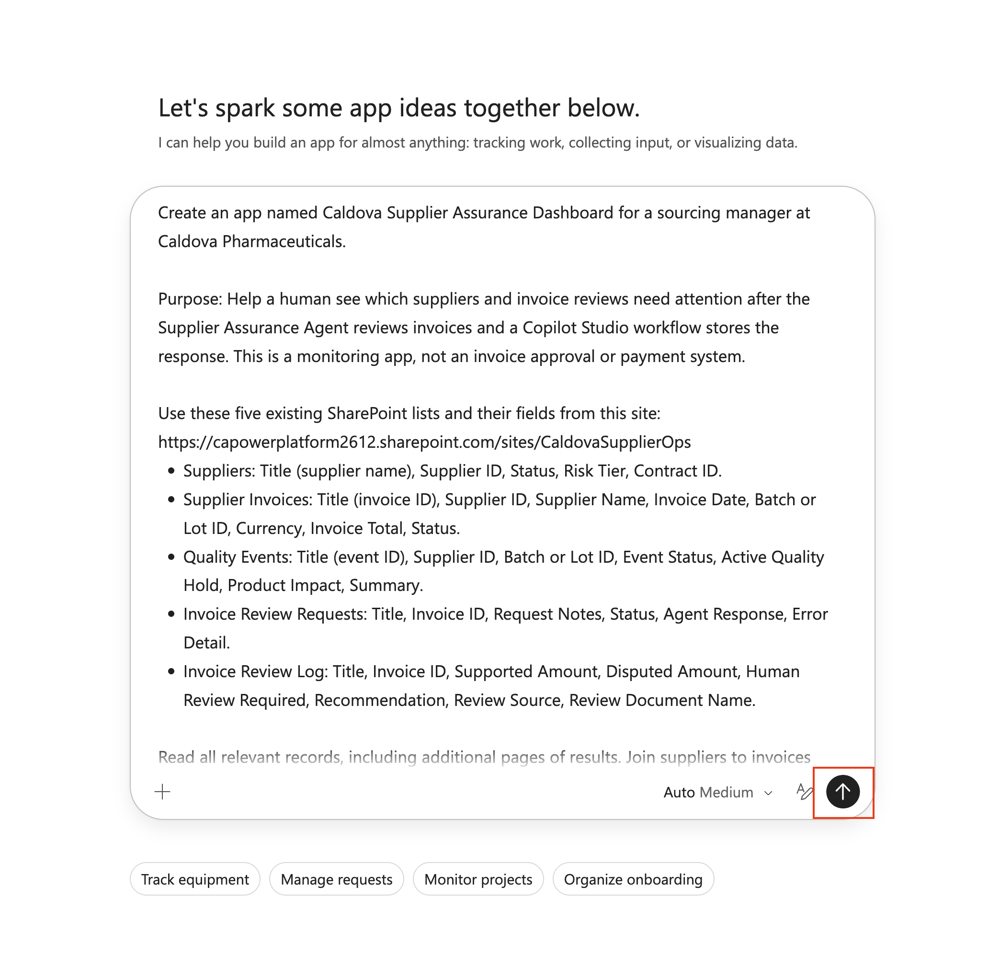

    > [!NOTE]
    > Allow several minutes; it can take 10 - 15 minutes. You can move onto the next lab while this runs if you'd like, just make sure to leave this tab open and check back on it.

1. Wait for the interactive app preview to appear. If it asks you any follow-up questions, provide your best answer.

    > [!NOTE]
    > Natural-language app creation generates the interface and logic together. The prompt defines observable behavior and boundaries, but it doesn't ensure an identical layout every time so your app might look different than the screenshot which is ok.

    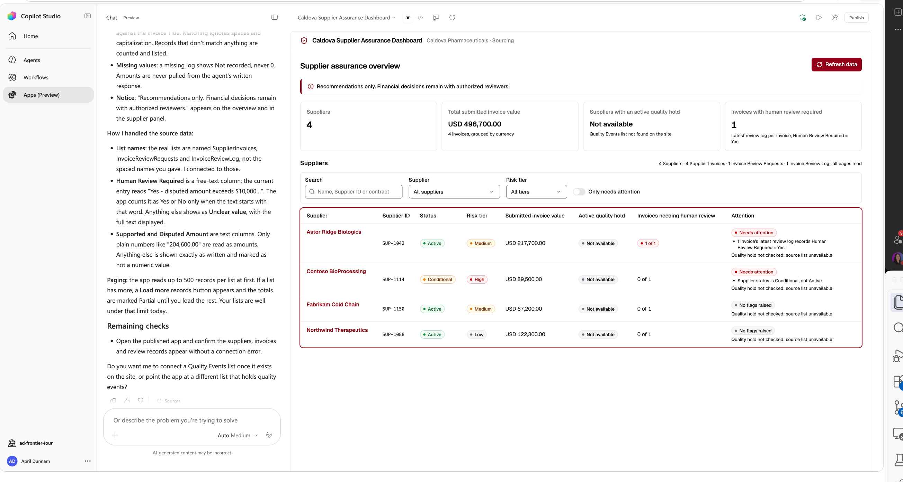

## Test the app

1. Test the searching by searching for **Astor Ridge**. Confirm that **Astor Ridge Biologics** appears and unrelated suppliers are excluded.

    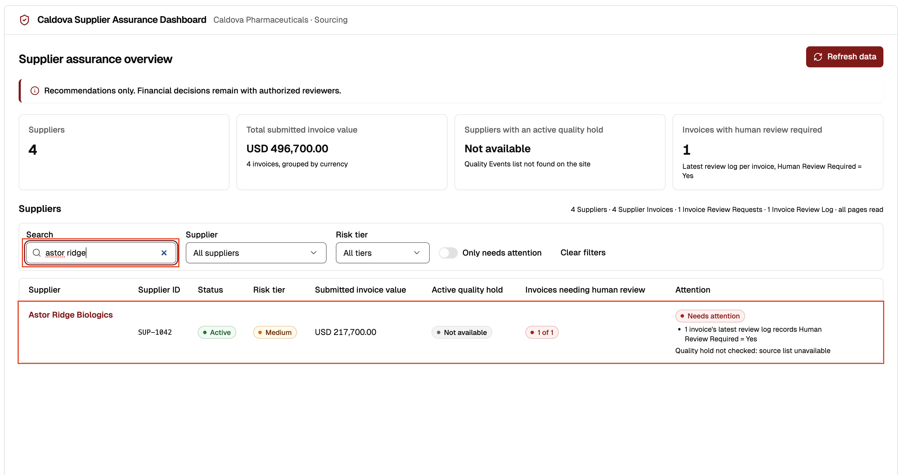

1. Clear the search by clicking the **x**. Set the risk-tier filter to **High**. Confirm that **Contoso BioProcessing** appears.

    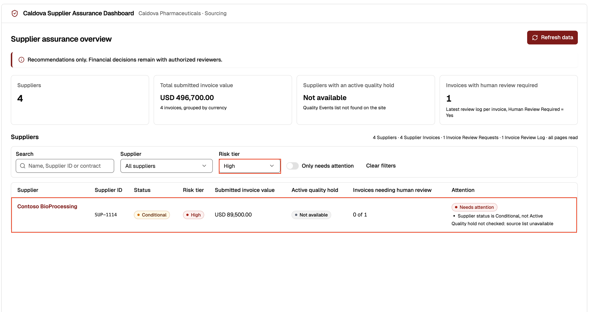

1. Set the risk-tier filter back to **all tiers**.

1. Turn on **Only needs attention**. Confirm that **Contoso BioProcessing** appears because it is Conditional and has an active quality hold. Confirm that **Astor Ridge Biologics** also appears if its recorded review has **Human Review Required = Yes**, even though the supplier is Active and its quality event has no active hold.

    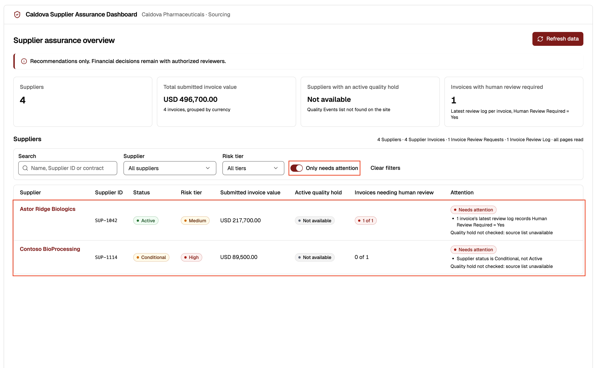

1. Turn off **Only needs attention**.

## Inspect the invoice reviews

1. Select **Astor Ridge Biologics** in the supplier table.

1. Look at invoice **ARB-260814** in the generated detail view.

1. Compare the displayed values with its source invoice and latest recorded review:

    | Field | Expected result from the earlier lab |
    | --- | --- |
    | Submitted invoice total | $217,700 |
    | Supported Amount | $204,600 |
    | Disputed Amount | $13,100 |
    | Human Review Required | Yes |
    | Review Source | Interactive Agent |
    | Review Document Name | Caldova_Supplier_Review_ARB-260814.pdf |

    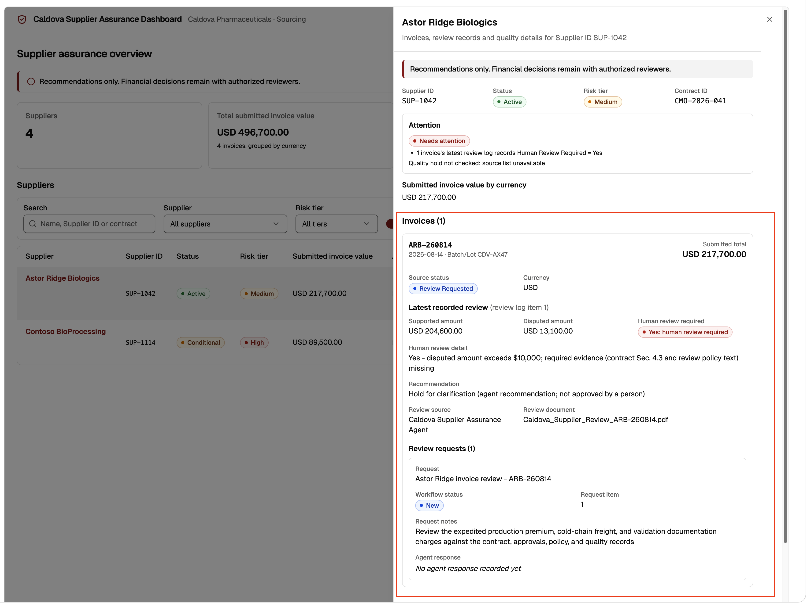

1. Select the **x** button to close out of this record.

## Refine the app through conversation

1. In the conversation area, copy and paste:

    ```text
    Refine the supplier detail view for a busy sourcing manager.

    Add a clearly labelled My attention section before the invoice table. Explain each applicable attention condition using the existing supplier status, active-hold flag, and latest recorded human-review-required flag. Show the invoice ID next to a review-related condition. Do not infer review outcomes from free-text responses.

    Keep quality investigation status separate from Active Quality Hold. When a structured review is missing, say No structured review recorded; do not say No issues found.

    Make the full workflow response expandable so it stays available without overwhelming the overview. Keep request completion separate from financial approval, preserve read-only behavior, and retain the recommendations-only notice.
    ```

1. Select **Enter** or the **Up arrow** to submit the prompt.

    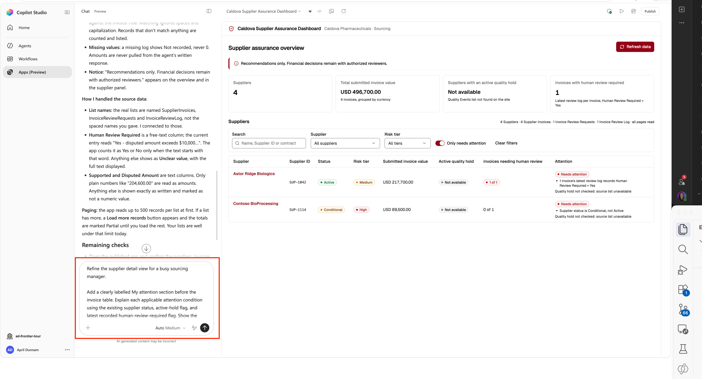

1. Wait for the preview to update (could take another 5-10 minutes).

1. Open **Contoso BioProcessing** and confirm **My attention** section shows and explains its Conditional status and active quality hold.

    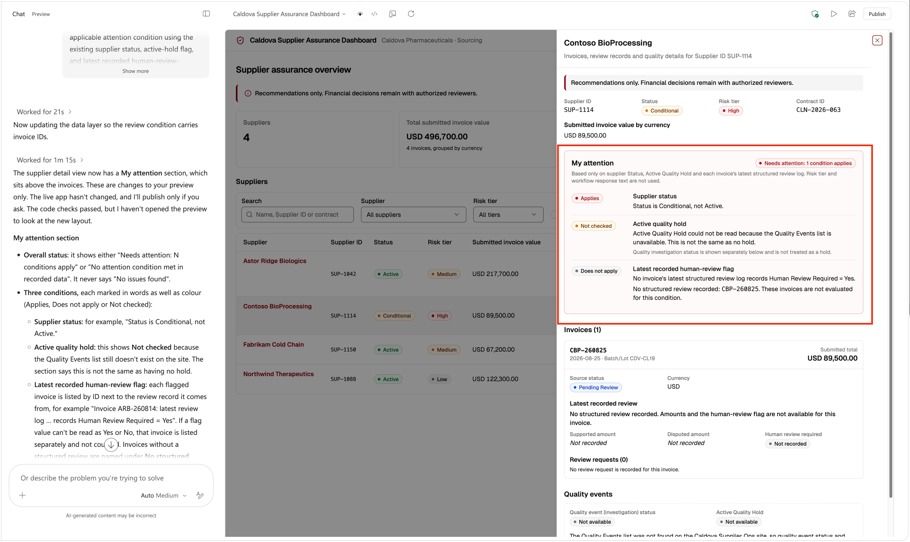

1. Select the **x** to close out of the record.

## Publish and open the app

1. Select **Publish** in the upper right hand corner to publish your app (this could take a couple of minutes to complete).

    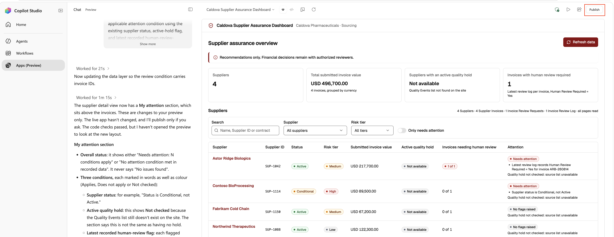

1. Select the **Play** button to run your published app.

    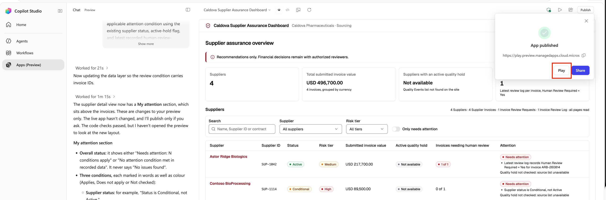

1. When you initially run the published app, it will ask you to allow access to the SharePoint data. Select **Allow** to proceed.

    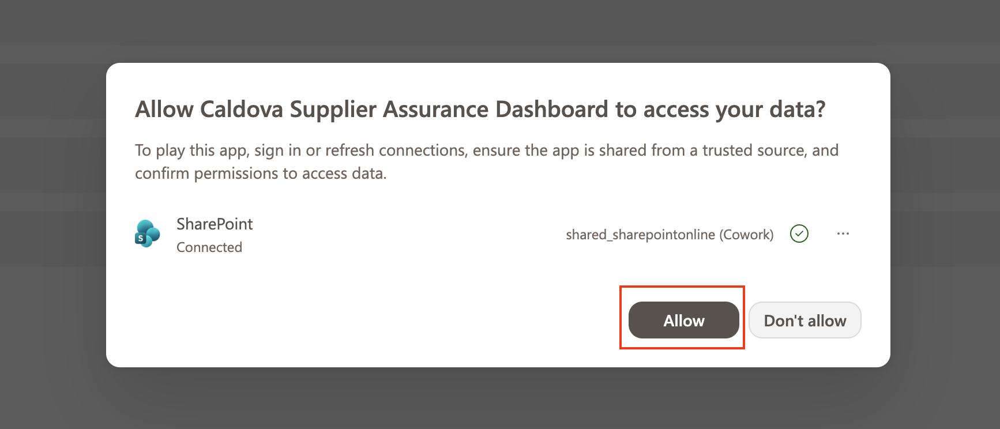

1. Explore the published app and make sure everything works as it did in preview. Confirm the supplier overview loads. Open Northwind's completed request and verify its response is available outside the authoring preview.

Select **Next** for the [optional Cowork bonus](./07-Bonus-Create-An-Agent-With-Cowork.md), or skip the remaining bonus and select **Submit** when the lab completion screen appears.
