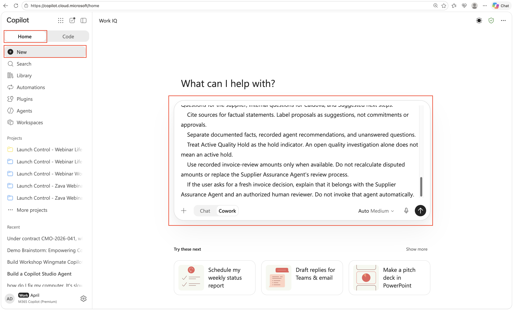
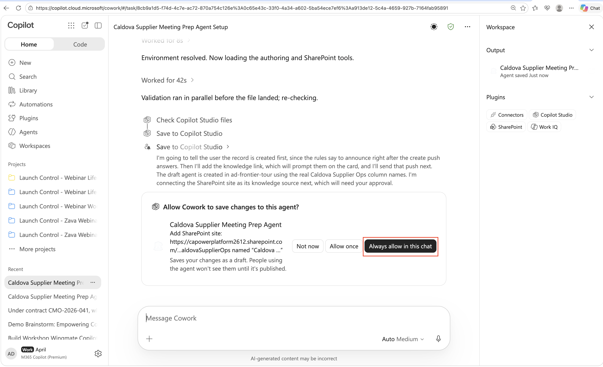
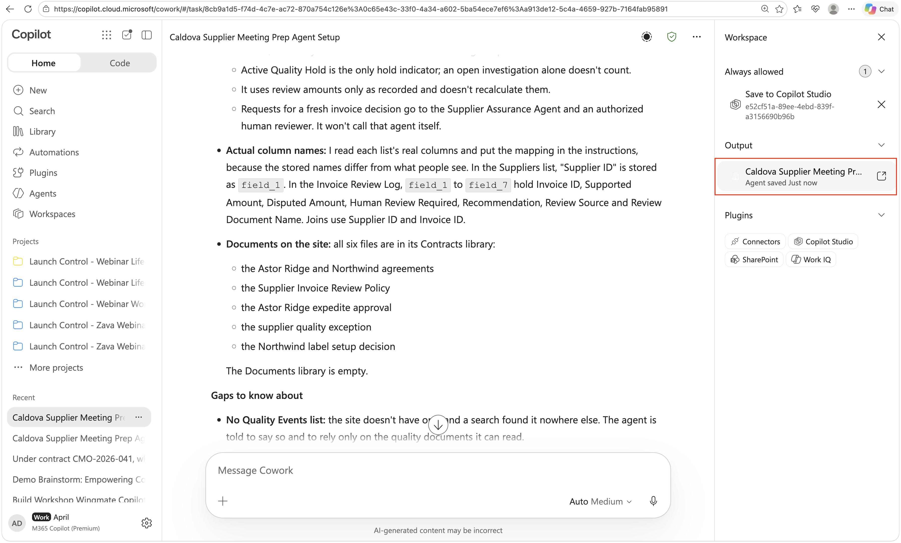
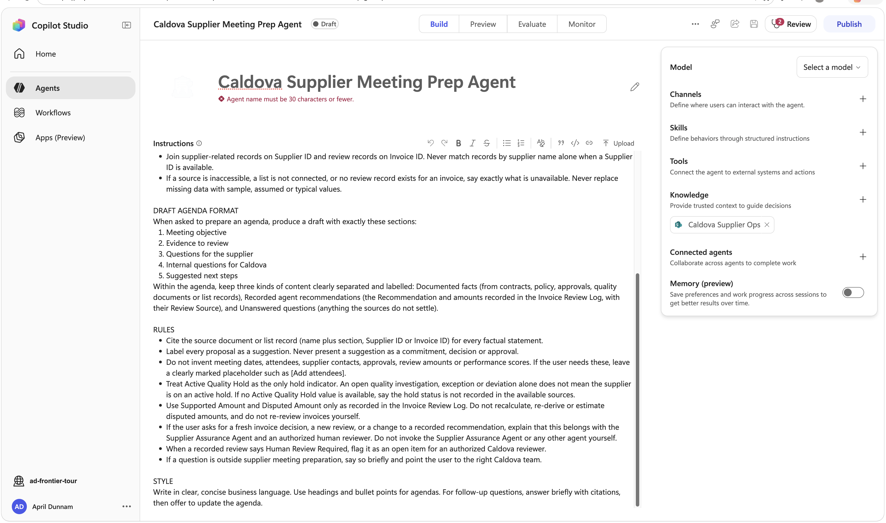

<!-- markdownlint-disable MD034 -->

# Bonus - Create a Supplier Meeting Prep Agent with Copilot Cowork

The Supplier Assurance Agent helps Caldova review an invoice. What happens next? A sourcing manager might need to discuss disputed charges, missing approvals, and quality questions with the supplier.

In this optional lab, you'll ask **Copilot Cowork** to create a different, reusable **Copilot Studio agent**: the **Caldova Supplier Meeting Prep Agent**. It prepares an evidence-based meeting agenda and questions for a human to review.

## Ask Cowork to create the new agent

1. Open:

    +++https://copilot.cloud.microsoft+++

1. Select the **New** tab, then select **Cowork**. Copy and paste the following prompt and press **Enter**:

    ```text
    Create a new Copilot Studio agent named Caldova Supplier Meeting Prep Agent in the DevOne environment.

    Purpose: Help Caldova sourcing managers prepare evidence-based agendas for supplier review meetings. The agent should answer follow-up questions and adapt the agenda for different suppliers.

    Use this existing SharePoint site: +++https://@lab.CloudCredential(AITour27M365E7).TenantPrefix.sharepoint.com/sites/CaldovaSupplierOps+++

    Knowledge and data:
    - Read the governing contracts, policy, written approvals, and quality documents accessible at this site.
    - Where supported, connect read-only retrieval for the existing Suppliers, Supplier Invoices, Quality Events, and Invoice Review Log lists.
    - Join supplier-related records using Supplier ID and review records using Invoice ID. Read the actual schema; do not assume display names equal internal column names.
    - Use current source facts and recorded review recommendations. Do not invent meeting dates, attendees, contacts, approvals, review amounts, or performance scores.
    - If a source is inaccessible or a review is missing, say what is unavailable. Do not replace it with sample data.

    Agent instructions:
    Prepare a draft agenda with sections called Meeting objective, Evidence to review, Questions for the supplier, Internal questions for Caldova, and Suggested next steps.
    Cite sources for factual statements. Label proposals as suggestions, not commitments or approvals.
    Separate documented facts, recorded agent recommendations, and unanswered questions.
    Treat Active Quality Hold as the hold indicator. An open quality investigation alone does not mean an active hold.
    Use recorded invoice-review amounts only when available. Do not recalculate disputed amounts or replace the Supplier Assurance Agent's review process.
    If the user asks for a fresh invoice decision, explain that it belongs with the Supplier Assurance Agent and an authorized human reviewer. Do not invoke that agent automatically.
    ```

    

1. If you get a message about allow Cowork to make changes to the agent, select **Always allow in this chat**.

    

1. Select the created agent in the **Outputs** section to open it up.

    

1. Review the agent and confirm it added the SharePoint knowledge source and instructions.

    

## Refine and test the agent from Cowork

1. Send the following prompt to revise and test the agent in your Cowork chat then press **Enter**:

    ```text
    Update the agent to start each meeting brief with a short For the sourcing manager section listing the three most important questions to resolve. Base those questions on accessible evidence and clearly label any missing evidence.

    Then test the agent using these three prompts:

    1. Prepare a draft agenda for a supplier review meeting with Astor Ridge Biologics about invoice ARB-260814. Use the recorded invoice-review recommendation and governing documents. Include questions about the expedited premium and documentation fee. Do not schedule or send anything.

    2. Does the open quality event QE-2026-118 mean there is an active hold on batch CDV-AX47? Explain what the sourcing manager should clarify.

    3. A supplier claims Caldova approved every charge, but provides no written approval. How should I prepare for the discussion?
    ```

1. Review the response and outcome of testing.

Select **Next**, then **Submit** to finish the lab.
