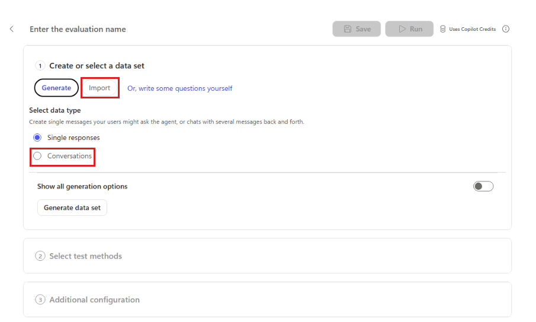
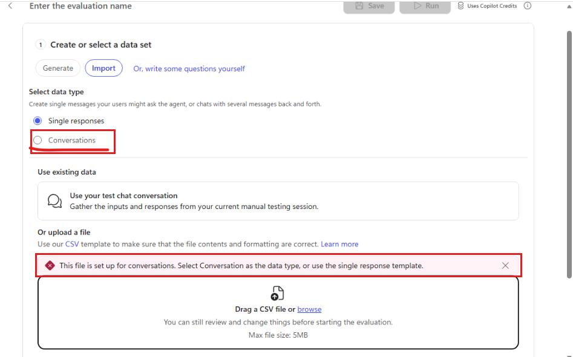
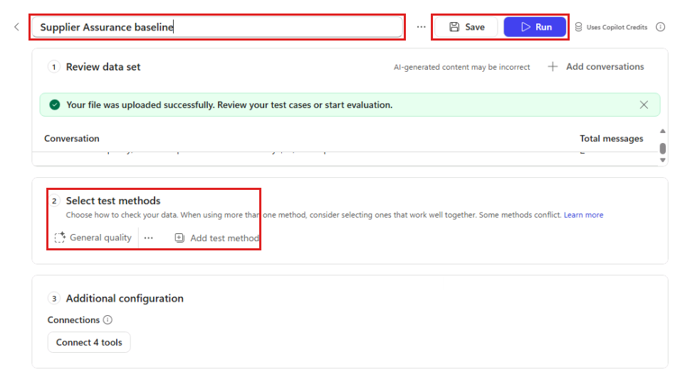

# 5 - Evaluate and Publish the Agent

Preview explains one conversation. Evaluation checks saved expectations repeatedly after the agent changes.

## Enable preference-only memory

1. Return to the agent overview and turn **Memory** on.
1. Save the agent.
1. In a new test session, enter:

    ```text
    Remember that I am based in London. Use UK date and time conventions, and put anything that needs my attention first under a heading called My actions.
    ```

1. Start another test session. Without restating the preference, enter:

    ```text
    Give me the Astor Ridge ARB-260814 review result. Include the invoice date.
    ```

1. Confirm the response puts required attention under **My actions** and shows the invoice date using a UK format such as `14 August 2026`, not `08/14/2026`.
1. Confirm the amounts, status, and evidence still come from the file, knowledge, and MCP rather than memory.

> [!IMPORTANT]
> **Why:** Location, date format, and personal working style are durable user preferences. Supplier facts, approval limits, case decisions, and quality status can change and must never come from memory.

## Evaluate the configured agent

1. Select the agent's **Evaluate** tab.
1. Select **Create your first evaluation**. If evaluations already exist, select **New evaluation**.
1. Under **Create or select a data set**, select **Import**. Under **Select data type**, select **Conversations**. In the file upload area, select **browse** and open this file:

    ```text
    C:\LabFiles\ILL224\evaluation\Supplier-Assurance-Baseline.csv
    ```

    > [!IMPORTANT]
    > The creation page defaults to **Generate** and **Single responses**. Change both selections before uploading this conversation CSV; do not generate a new data set or use the single response template.

    

    > [!TIP]
    > If you see "This file is set up for conversations. Select Conversation as the data type, or use the single response template.", select **Conversations**, then use **browse** to upload the same CSV again if needed. Do not edit the CSV or switch to the single response template.

    

1. Enter `Supplier Assurance baseline` in the evaluation name field at the top of the main page.

    

1. Under **Review data set**, confirm the import contains two conversations: the multi-turn Astor Ridge review and the **$10,000** human-review policy threshold.
1. Under **Select test methods**, below **Review data set** on the main page, keep **General quality**.
1. Review the reference responses so you understand the expected facts and guardrails. They guide your review but are not directly compared with the agent's responses.
1. Under **Additional configuration**, check **Connections**. If tools need a connection, select **Connect** and use the same learner connection used for SharePoint. The button includes the number of tools that need connecting.
1. Select **Save** at the top of the page to save the evaluation, then select **Run** to start it. **Save** alone does not start a run; use the **Run** control rather than looking for an **Evaluate** button.

    > [!NOTE]
    > The evaluation can take 5 - 10 minutes to run.

1. Inspect each result. Do not weaken an expected result merely to make a failure pass.

> [!NOTE]
> **Why:** A multi-turn conversation tests whether the agent maintains case context while preserving its grounding and action guardrails. General quality evaluates the conversation without requiring identical wording.

## Publish

1. Save the agent.
1. Select **Publish** and wait for completion.

**Verify:** The baseline has run, memory applies a user-specific regional and working preference across sessions, case facts remain grounded, and the agent is published.

Select **Next** to build the workflow.
